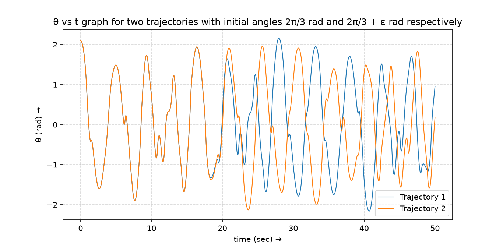
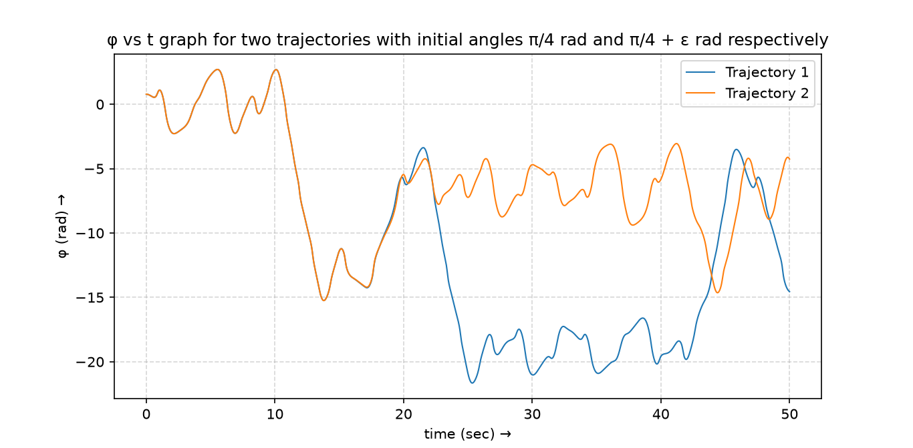
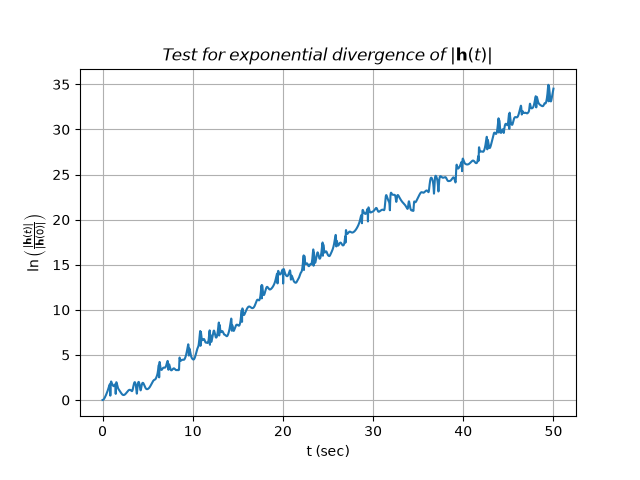
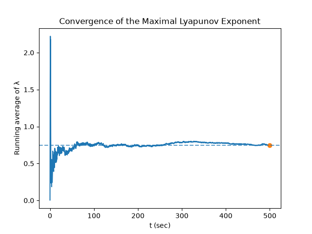
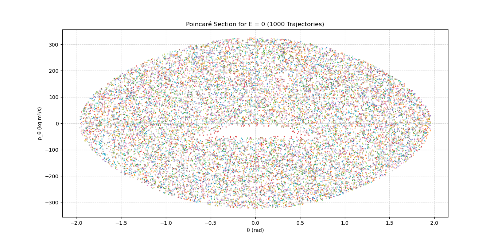
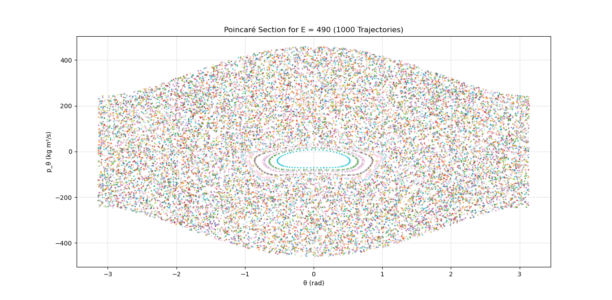

# Ideal-Double-Pendulum

<video src="https://github.com/user-attachments/assets/1c8e92d8-bb60-4b22-9ca0-a5ff6247a389" width="100%" autoplay loop muted>
</video>

Analytical and Numerical analysis of the chaotic behavior of the ideal Double Pendulum

This project aims to explore numerical and analytical techniques to analyze and
make global statements about the trajectories of non-integrable chaotic
dynamical systems in classical mechanics using the ideal double pendulum as an
example.

The dynamics of the double pendulum are governed by two coupled nonlinear
second-order differential equations for the angular coordinates θ and φ.
Since the system has two degrees of freedom but only one independent conserved
quantity, the total energy, it does not satisfy the conditions for Liouville
integrability and is therefore non-integrable.

Numerical integration of the differential equations for a particular initial
state and an infinitesimal perturbation of that state produces significantly
different trajectories, demonstrating sensitivity to initial conditions.
Together with the system's non-integrability and bounded dynamics, this
indicates chaotic behaviour.

| θ vs Time | φ vs Time |
| :---: | :---: |
|  |  |

The evolution of an infinitesimal perturbation is then studied through its
variational equations, and the maximal Lyapunov exponent is calculated using the
Benettin algorithm, quantifying the exponential divergence of nearby
trajectories.

| Test for exponential divergence | Convergence of the maximal Lyapunov exponent |
| :---: | :---: |
|  |  |

Poincaré sections for various energy levels are then plotted to visualize the
geometric structure of regular and chaotic dynamics.

| E = 0J | E = 490J |
| :---: | :---: |
|  |  |

All simulations were implemented using open-source Python libraries,
specifically NumPy and Matplotlib.

